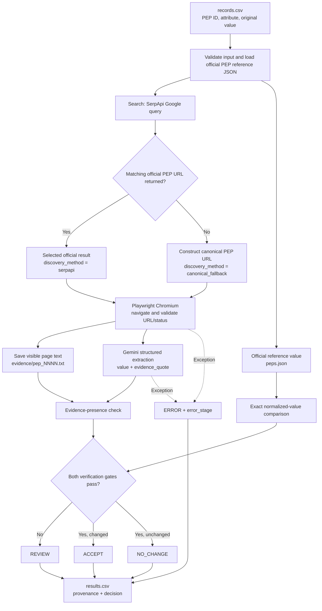

! use shortcut - cmd+shift+v
! use - cmd+shift+p : markdown 

# Evidence-Grounded AI Data Retrieval Agent

**First-week research prototype for Dr. Sibdari — October 23, 2026**

A small, auditable Python pipeline that identifies a missing or questionable attribute in a dataset; discovers and fetches an official public webpage; uses Gemini to extract a candidate replacement and evidence quote; verifies the candidate against an authoritative reference; and records a proposed correction with provenance.

> **Status:**Sucessfully processed **8 of 8 synthetic PEP test cases** with `ACCEPT`, zero `REVIEW`, and zero `ERROR` results. The observed pass rate applies to this deliberately constructed, limited test set **only**, not to unfamiliar sources or real-world ambiguous records. This README describes the existing implementation; it is not proof of additional tests.

## 1. Research problem and objective

Real datasets have missing, incorrect, or outdated attributes. A language model can suggest a plausible answer, but plausibility is not sufficient. The objective is to produce a **traceable proposed correction** that includes the original value, retrieved value, source URL, supporting evidence, verification outcome, and decision.

The first-week benchmark uses **Python Enhancement Proposals (PEPs)** because the official PEP site publishes human-readable pages and a machine-readable JSON index. We deliberately remove or corrupt values in a tiny CSV, then attempt to recover them from the public webpage and compare the result with the official JSON record. These defects are **synthetic**; they do not imply errors in the PEP website.

## 2. Architecture



**Separation of responsibilities:** The LLM **proposes** a candidate; deterministic validators **decide whether the candidate passes the current acceptance rules**. The input CSV is not silently overwritten. The official JSON reference is loaded before processing records.

## 3. Tools and why they are used

| Component | Tool | Actual responsibility | Why chosen |
|---|---|---|---|
| Input/output | Python `csv` | Read `records.csv`, write `results.csv` | Simple, transparent, portable |
| Search discovery | `serpapi` | Google query; inspect organic result links | Search discovery without manually parsing a search-result page |
| Fallback discovery | Python URL template | Build `https://peps.python.org/pep-NNNN/` | Controlled fallback for this specific dataset when no matching search result appears |
| Browser retrieval | Playwright + Chromium | Navigate, validate HTTP/redirect, read `body.inner_text()` | Real-browser path that can handle JavaScript-rendered content when necessary |
| Structured extraction | Gemini via `google-genai` | Extract one field and a short literal quote into validated JSON | Handles semi-structured text and varying field presentation |
| Output schema | Pydantic | `Extraction(value, evidence_quote)` | Predictable JSON fields and data validation |
| Reference verification | `requests` + official PEP API | Load and compare the expected field | Deterministic reference comparison in the benchmark |
| Provenance | Local evidence files + CSV | Preserve source text, URL, search method and verification flags | Makes results reproducible and reviewable |

Official API: https://peps.python.org/api/ and https://peps.python.org/api/peps.json

## 4. Project contents

```text
ai-data-retrieval-agent/
├── agent.py           # Working agent implementation
├── records.csv        # Eight intentionally imperfect test records
├── .env               # Private API keys and selected Gemini model
├── .gitignore         # Excludes secrets, venv and generated outputs
├── README.md          # This document
├── scraping_demo.py   # Optional standalone scraper comparison
├── results.csv        # Generated decisions, values, and provenance
└── evidence/
    ├── pep_0008.txt
    ├── pep_0020.txt
    └── ...             # Captured webpage text, one per fetched PEP
```

`results.csv` and `evidence/` are runtime outputs. You may keep a sanitized sample for a meeting or publication, but do not confuse test outputs with independently curated truth data.

## 5. Setup and execution

**Requirements:** Python 3.10+; reachable PEP site; API keys for SerpApi and Gemini; Playwright Chromium installed.

```bash
python3 -m venv .venv
source .venv/bin/activate
python -m pip install -U pip
python -m pip install serpapi playwright google-genai pydantic python-dotenv requests beautifulsoup4
python -m playwright install chromium
```

Create `.env` (**never commit this file**):

```dotenv
SERPAPI_KEY=your_serpapi_key
GEMINI_API_KEY=your_gemini_api_key
GEMINI_MODEL=gemini-3.5-flash-lite
```

Example input `records.csv`:

```csv
pep_number,attribute,current_value
8,status,
20,type,
257,created,
484,status,Draft
572,type,Process
617,status,
695,created,
703,title,Unknown
```

Run a single-record demonstration:

```bash
python agent.py --pep 8
```

Run all eight:

```bash
python agent.py
```

Inspect outputs:

```bash
head -n 4 results.csv
ls evidence/
```

**Important:** Running `--pep 8` writes `results.csv` containing only the selected record, because the current code overwrites that output file. Run the full command again to restore the eight-row results before presenting aggregate metrics.

## 6. Walkthrough of the actual code

The current `agent.py` follows these stages:

1. **Configuration and schema:** `load_dotenv()` reads credentials; `Extraction(BaseModel)` declares optional `value` and `evidence_quote` fields. `VALID_FIELDS` restricts attributes to `title`, `status`, `type`, and `created`.
2. **Reference load:** `load_reference_data()` downloads `https://peps.python.org/api/peps.json`. It provides the comparison values for each PEP. Loading once avoids an extra reference request per record.
3. **Search discovery:** `discover_source(pep_number, search_client)` queries SerpApi with `PEP N site:peps.python.org` and inspects `organic_results`. `is_official_pep_url` validates protocol, host, and exact PEP path. When no exact match is returned, the code constructs the known official PEP URL and saves the discovery method and search issue. The fallback still must pass browser retrieval checks.
4. **Browser retrieval:** `fetch_source(browser, url, pep_number)` launches a new Playwright page, navigates with `wait_until="domcontentloaded"`, checks HTTP status and the final official URL, waits for `body`, then calls `body.inner_text()`. It saves a UTF-8 text snapshot as `evidence/pep_NNNN.txt`, then closes the page. **It does not currently target specific PEP metadata DOM selectors or prove JavaScript rendering was required on the PEP site.**
5. **Gemini extraction:** `extract_attribute(...)` provides a limited slice of the captured body text (first 12,000 characters), target ID and attribute, and rules against guessing. `generate_content()` requests JSON conforming to the Pydantic extraction schema with temperature set to zero. The code parses and validates the response. `temperature=0` may make generation more consistent; it does not guarantee factual correctness.
6. **Verification:** `verify_extraction(...)` checks that the returned quote occurs in normalized captured page text and that the normalized candidate value equals the official JSON reference field. If either gate fails, it marks `REVIEW`. If both pass and the value differs from the original, `ACCEPT`; if it is already the same, `NO_CHANGE`.
7. **Error handling:** `process_record` catches record-level errors and sets `ERROR`, `error_stage`, and `error`, so other records can still run. Errors may occur in input validation, discovery, retrieval, extraction, or verification.
8. **Persistence and summary:** `save_results` exports data and provenance; `print_summary` gives counts and a verified pass rate for the processed input records.

The current process is a **tool-orchestrated extraction pipeline** (sometimes described as an agentic workflow). It does not yet autonomously plan arbitrary multistep web investigations, select among competing sources, or iterate based on uncertainty.

## 7. Provenance, validation and status meanings

Important columns in `results.csv`:

| Column | Meaning |
|---|---|
| `pep_number`, `attribute`, `current_value` | Target and the input value |
| `retrieved_value` | LLM's proposed replacement |
| `source_url` | Final official page URL after browser navigation |
| `search_query` | Search issued to SerpApi |
| `discovery_method` | `serpapi` or `canonical_fallback` |
| `search_issue` | Why the matching search result was not selected, if applicable |
| `evidence_quote` | Short quote from LLM output |
| `evidence_file` | Stored page-body text captured by Playwright |
| `reference_value`, `verification_url` | Benchmark comparison value and JSON source |
| `evidence_valid`, `reference_matches` | The two implemented acceptance gates |
| `decision` | `ACCEPT`, `NO_CHANGE`, `REVIEW`, or `ERROR` |
| `error_stage`, `error`, `checked_at` | Failure context and UTC processing timestamp |

**Status definitions:**

- `ACCEPT`: the output passes both current checks and proposes a changed value; **not automatically an authorized write to the production dataset**.
- `NO_CHANGE`: the output passes both checks and matches the existing input value.
- `REVIEW`: extraction completed but one or both verification gates failed; retain the original until manual review.
- `ERROR`: a stage failed technically; the result is not a factual decision.

### Limitations of the verification method

- The PEP webpage and official PEP JSON API are two presentations of the **same authoritative PEP data**. Their agreement is a convenient benchmark oracle, **not independent two-source corroboration**.
- The evidence check finds the quote somewhere in the page text. It does not yet establish that the quote semantically refers to exactly the requested field or entity.
- There is no implemented confidence score, consensus voting, temporal freshness check, duplicate entity resolution, or general-purpose trust ranking. Avoid saying these exist.
- `ACCEPT` is based on exact normalized comparison, appropriate for this narrow benchmark, but insufficient for dates with alternative formats, aliases, or context-dependent values.
- No independent labeled test set or out-of-domain evaluation has been run in the provided results.

## 8. Observed results (user-reported run)

| PEP | Field | Proposed retrieved value | Discovery method | Decision |
|---:|---|---|---|---|
| 8 | status | Active | serpapi | ACCEPT |
| 20 | type | Informational | canonical_fallback | ACCEPT |
| 257 | created | 29-May-2001 | canonical_fallback | ACCEPT |
| 484 | status | Final | serpapi | ACCEPT |
| 572 | type | Standards Track | serpapi | ACCEPT |
| 617 | status | Final | canonical_fallback | ACCEPT |
| 695 | created | 15-Jun-2022 | serpapi | ACCEPT |
| 703 | title | Making the Global Interpreter Lock Optional in CPython | canonical_fallback | ACCEPT |

**Counts:** 8 processed; 8 accepted; 0 review; 0 errors. Four official URLs were discovered in the search results, and four used canonical fallback. The user-reported reference file contained 746 PEP objects at the time of that run. These are **observations from one execution**, not a population-level accuracy estimate.

## 9. Web scraping: concepts and engineering decisions

### Discovery is not scraping

- **Discovery** locates *which URL* might contain an answer. SerpApi supplies search result metadata, including organic links.
- **Retrieval** requests an actual source page and checks it loaded successfully.
- **Parsing/scraping** transforms page HTML/DOM into useful structured or textual data.
- **Extraction** isolates a requested fact from that data; here Gemini returns `value` + `evidence_quote`.
- **Verification** tests a proposed fact against evidence/reference rules.

### HTML and the DOM

A page's HTML is source markup such as `<dt>Status</dt><dd>Active</dd>`. The **Document Object Model (DOM)** is a tree representation of the page that can be queried by tags, CSS selectors, or other locators. Browser JavaScript can add or modify DOM nodes after the initial HTML response. The text visible on a page may therefore differ from raw server HTML.

### Static extraction: requests + BeautifulSoup

For server-rendered content, a lightweight HTTP request and parser are often sufficient:

```python
import requests
from bs4 import BeautifulSoup

url = "https://peps.python.org/pep-0008/"
response = requests.get(url, timeout=20)
response.raise_for_status()
soup = BeautifulSoup(response.text, "html.parser")
print(soup.title.get_text(" ", strip=True) if soup.title else "No title")
```

**Pros:** fast, small memory footprint, no browser process. **Cons:** it does not run JavaScript. Parsing the entire page body may mix navigation text, article text, related links and metadata.

### DOM selectors

In a browser, selectors target the exact data-bearing element, for example `page.locator("main")` or `page.locator(".metadata")` **when those selectors exist on the target site**. Inspect the actual markup in DevTools before choosing selectors. Avoid assuming every website uses the same structure. For PEPs, a sensible future enhancement is to locate the specific metadata definition list instead of asking Gemini to read up to 12,000 characters from the page body.

### Dynamic rendering: Playwright

Playwright controls Chromium, Firefox or WebKit. A browser can execute scripts, follow client-side navigation and wait for asynchronous DOM updates. The current pipeline uses Chromium to retrieve `body.inner_text()`, but has **not** established that the PEP pages require JavaScript. For dynamic sites, wait for the desired selector/content rather than sleeping a fixed number of seconds.

```python
from playwright.sync_api import sync_playwright

with sync_playwright() as p:
    browser = p.chromium.launch(headless=True)
    page = browser.new_page()
    page.goto("https://peps.python.org/pep-0008/", wait_until="domcontentloaded")
    print(page.locator("body").inner_text()[:500])
    browser.close()
```

**Pros:** sees rendered DOM; supports sophisticated browser interactions. **Cons:** slower and more resource-intensive than direct HTTP; dynamic page behavior introduces timing and reliability problems.

### Prefer a documented API when it satisfies the need

An official JSON/API endpoint is usually more stable and cheaper to consume than HTML scraping. This prototype intentionally reads a webpage to demonstrate web retrieval, but uses the PEP JSON API as its reference. In a production data pipeline, prefer authoritative structured endpoints whenever allowed and appropriate.

### Responsible crawling and reliability

1. Review the site's terms, applicable permissions, published APIs and `robots.txt` guidance before automated collection. Robots instructions manage crawling traffic; they are not an authorization mechanism by themselves.
2. Set realistic timeouts; handle 404, 403, 429, 5xx, redirects, and malformed content explicitly.
3. Limit concurrency and per-domain request rate; use a bounded exponential backoff when the site permits retries, including `Retry-After` where applicable. Do **not** retry 403/429 aggressively or bypass CAPTCHAs/access controls.
4. Cache retrieved pages where appropriate, store fetch timestamps, and avoid recrawling unchanged URLs.
5. Use a host allowlist and validate redirected destinations before using fetched data in an agent; do not let arbitrary content supply new instructions or uncontrolled URLs.
6. Strip navigation and irrelevant text, minimize data passed to the LLM, and avoid collecting private or sensitive information unnecessarily.
7. Keep a reproducible trail: source URL, fetch timestamp, method, captured content, quote, model identifier, validation result and exception details.

For an interactive explanation, run `python scraping_demo.py`, which contrasts raw HTML parsing, live Playwright page retrieval and browser-executed JavaScript on a safe in-memory example.

## 10. Research evaluation plan (next milestone, not yet implemented)

Separate the following metrics rather than reporting one unqualified accuracy figure:

- **Discovery success:** percentage of official URLs found via search without canonical fallback.
- **Retrieval success:** percentage of target webpages fetched and validated.
- **Extraction correctness:** correct attribute values divided by cases with independently labeled truth.
- **Evidence validity:** percentage with an authentic supporting quote relevant to the target fact.
- **Coverage/abstention:** how often the pipeline returns `REVIEW` instead of inventing an answer for unsupported cases.
- **Efficiency:** requests per record, latency per stage, cost per extracted field.

Suggested follow-up cases: a record with an already-correct value (`NO_CHANGE`), an unsupported field (`ERROR`), a missing webpage, a model returning an incorrect value (`REVIEW`), conflicting source claims, a record with ambiguous identity, and a recent value that may have changed.

For a future model comparison, contrast **deterministic CSS/DOM extraction vs. Gemini extraction** on the same labeled records. Assess correctness, provenance quality, latency, and cost.

## 11. Five-minute meeting walkthrough

1. **Problem (45 s):** We have small data gaps. We need corrections backed by evidence rather than plausible guesses.
2. **Architecture (60 s):** Input → SerpApi discovery (with controlled fallback) → Playwright fetch → Gemini JSON extraction → evidence and reference checks → auditable output.
3. **Live demo (90 s):** Run `python agent.py --pep 8`; show official PEP page, evidence text file, and relevant CSV fields.
4. **Scraping (60 s):** Explain raw HTML vs DOM; demonstrate Playwright's ability to render JavaScript using `scraping_demo.py`. Emphasize that the PEP pages themselves may not need a browser.
5. **Research questions (45 s):** How should the system handle ambiguous identities, multiple disagreeing sources, temporal changes, and human review?

**Backup plan:** Before the meeting, run `python agent.py` to restore all eight results. Keep a terminal screenshot or sanitized excerpt of `results.csv` and one `evidence/pep_0008.txt` file available in case a live API call fails.

## 12. Current technical limitations and future architecture

This prototype is intentionally narrow and synchronous. It uses a **known URL template**, a **single trusted domain**, **one source per record**, and an **official-reference equality check**. It also repeatedly searches individual PEP IDs rather than deduplicating/cacheing searches. It is therefore a good first-week demonstration, not yet a general autonomous web research agent.

For a real dataset, the next architecture should introduce: input normalization and entity resolution; multi-source ranking; robust metadata-specific parsers and browser fallback; retry/backoff and caching; supporting quote-to-field attribution; conflict and temporal freshness handling; calibrated abstention/manual review; and benchmarked accuracy and cost reporting.

## 13. Official documentation

- PEP JSON API: https://peps.python.org/api/
- SerpApi Python client: https://serpapi-python.readthedocs.io/en/latest/user_guide/client-usage.html
- Playwright Python: https://playwright.dev/python/docs/api/class-page
- Google Gemini structured outputs: https://ai.google.dev/gemini-api/docs/structured-output
- Robots.txt introduction: https://developers.google.com/search/docs/crawling-indexing/robots/intro
