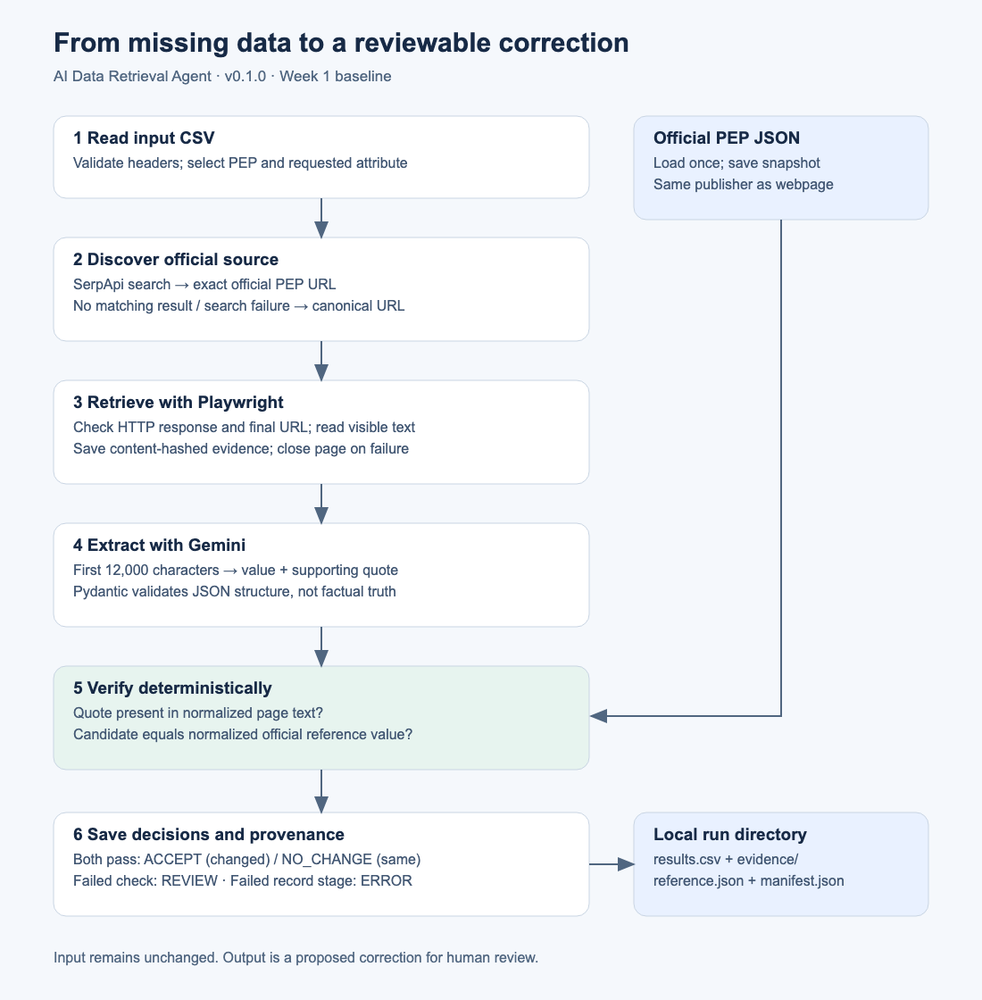
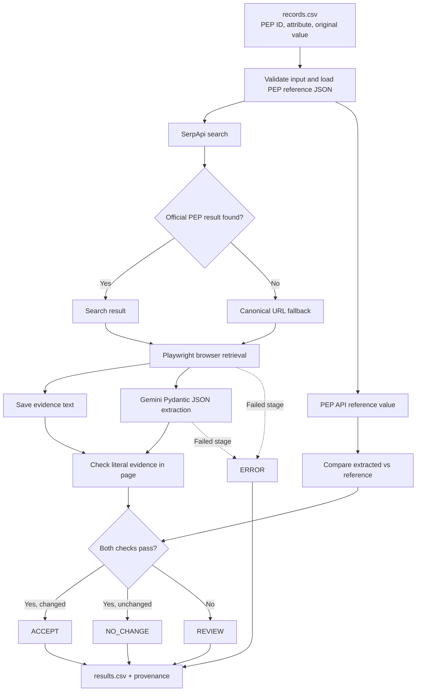

# Evidence-Grounded AI Data Retrieval Agent

**v0.1.0 · Week 1 research baseline**

This Python program proposes corrections to a small CSV of Python Enhancement
Proposal (PEP) metadata. It searches for the official page, opens it in a browser,
asks Gemini for one value and a supporting quote, then checks that value against
the official PEP JSON dataset. It writes results for review; it never edits input data.

The eight input records contain deliberately missing or incorrect values. They are
an educational benchmark, not evidence of errors on python.org. This is a fixed,
sequential tool workflow, not a general autonomous research agent.

## Start here

1. Install Git and Python 3.13 (the baseline was verified with **3.13.5 on macOS ARM64**).
2. Clone this repository and create an isolated Python environment below.
3. Install the pinned packages and Chromium browser.
4. Run the offline tests; no API keys are needed for these.
5. Copy `.env.example` to `.env` and enter your own provider keys.
6. Review [scraping policy and concepts](docs/scraping.md), then try one PEP.

All commands run in the repository folder. Type terminal commands at the shell
prompt. Python statements such as `from urllib.robotparser import RobotFileParser`
belong in a `.py` file or the Python interpreter, **not directly in zsh/PowerShell**.

## Clone and install

### macOS or Linux

```bash
git clone https://github.com/jaideep1021/ai-data-retrieval-agent.git
cd ai-data-retrieval-agent
git checkout v0.1.0
python3.13 -m venv .venv
source .venv/bin/activate
python -m pip install -r requirements.txt
python -m playwright install chromium
python -m pip check
python -m unittest discover -s tests -v
cp .env.example .env
```

If your Python 3.13 executable is named `python3`, substitute that after checking
`python3 --version`. On supported Linux systems, browser system libraries may also
be needed: `python -m playwright install --with-deps chromium` (may request sudo).
The browser install is a separate step from installing the Python package.
See [Playwright browser installation](https://playwright.dev/python/docs/browsers).

### Windows PowerShell

```powershell
git clone https://github.com/jaideep1021/ai-data-retrieval-agent.git
cd ai-data-retrieval-agent
git checkout v0.1.0
py -3.13 -m venv .venv
.\.venv\Scripts\python.exe -m pip install -r requirements.txt
.\.venv\Scripts\python.exe -m playwright install chromium
.\.venv\Scripts\python.exe -m pip check
.\.venv\Scripts\python.exe -m unittest discover -s tests -v
Copy-Item .env.example .env
```

Using the executable directly avoids PowerShell activation-policy issues. For all
later `python` commands on Windows, use `.\.venv\Scripts\python.exe` instead.
Windows/Linux instructions are provided but were not locally executed; see
[verification](docs/verification.md) for actual checks and CI status boundaries.

`requirements.in` lists direct packages; `requirements.txt` pins the full resolved
environment. These are version pins, not a hash-verified supply-chain lock. Do not
upgrade packages individually when reproducing this release.

## Set up API access

Open `.env` in a text editor and replace the two placeholders:

```dotenv
SERPAPI_KEY=your_actual_serpapi_key
GEMINI_API_KEY=your_actual_gemini_api_key
GEMINI_MODEL=gemini-3.5-flash-lite
```

- Create/sign in to [SerpApi](https://serpapi.com/manage-api-key) and copy your API key.
  The package is `serpapi`, the [official Python client](https://serpapi.com/integrations/python).
- Create a Gemini API key in [Google AI Studio](https://aistudio.google.com/apikey).
  Ensure your account/project can use the configured model and has quota.
- Never paste keys into Python source, screenshots, issues or commits. `.env` is ignored.
- Existing environment variables take precedence over `.env`. Only the specified
  `.env` file is loaded; parent folders are not searched. `--env-file PATH` supports
  an existing private file outside this repository.
- `gemini-3.5-flash-lite` preserves the working Week 1 configuration. Model
  availability can change; changing it is an experiment and should be documented.
- Live execution uses provider quotas and may incur charges. One full sample run
  requests eight searches and eight model extractions, plus provider SDK retries.

## Run and inspect

```bash
python agent.py --version
python agent.py --pep 8
python agent.py
```

Each command creates a **new** `runs/<UTC-time>-<unique-id>/` directory. For an easy
to-find output, choose a directory that does not exist yet:

```bash
python agent.py --pep 8 --output-dir runs/first-demo
python agent.py --input examples/records.csv --output-dir runs/all-eight
```

An existing output directory is rejected, preserving its results. Unlike the original
prototype, v0.1.0 does not overwrite a root-level `results.csv` or `evidence/`.
Results are saved after processing (including completed rows on an interruption
that unwinds Python); abrupt process termination or power loss can still lose rows.

For the single-record example, a successful run usually reports `Active` and `ACCEPT`
for PEP 8, plus verification flags set to true. The full example processes eight
rows. Exact values, search fallback frequency, model quotes and pass counts can
change. A historical eight-of-eight success does not promise future accuracy.

Open `runs/first-demo/results.csv` in a text editor or spreadsheet. Inspect the
supporting text in `runs/first-demo/evidence/pep_0008_<content-hash>.txt`. Keep generated output
local. Each run also includes:

| File | Purpose |
|---|---|
| `results.csv` | Proposed values, decisions, provenance and failure stages |
| `evidence/pep_NNNN_<content-hash>.txt` | Full visible page-body text, not original HTML |
| `reference.json` | The parsed official JSON snapshot used for comparison |
| `manifest.json` | Baseline version, model, UTC time, Python version, input and reference SHA-256 hashes |

The input hash identifies the full input file, even with `--pep`. Preserve your input
alongside the run if you need to replay it; the program does not copy private input.
Evidence hashes detect later file changes; they do not authenticate the publisher.
Evidence filenames include a content hash, so different captures of the same PEP
within a run retain separate files; identical captures reuse the same file.

Exit status is 1 for technical errors, otherwise 0. `REVIEW` is a completed decision,
so it does not produce a nonzero exit status. Always inspect decisions, not just exit status.

## Input and decisions

```csv
pep_number,attribute,current_value
8,status,
20,type,
257,created,
484,status,Draft
```

Required headers are `pep_number`, `attribute`, `current_value`. Leave the current
value empty when unknown. PEP IDs must be nonnegative integers; supported fields
are `title`, `status`, `type`, `created`. Bad rows become `ERROR` and later rows
continue; missing headers/empty input fail before API calls. `--pep` selects only
matching IDs, so malformed IDs outside that filter are not processed.

| Decision | Meaning |
|---|---|
| `ACCEPT` | Quote is present, value matches reference, and differs from input |
| `NO_CHANGE` | Same checks pass and input already matches |
| `REVIEW` | Quote missing/invented or candidate does not match reference |
| `ERROR` | A technical or validation stage failed; no factual conclusion |

Comparison collapses whitespace and ignores case. It does not normalize dates or
prove a quote supports the requested field. A quote from anywhere in the page can
pass the presence check. The webpage and JSON come from the **same publisher**;
they are not independent corroboration. `ACCEPT` is a proposed correction for human
review, not authorization to change a production dataset.

## Architecture and code walkthrough



The [SVG](docs/architecture.svg) and PNG open without a Mermaid extension. The editable source is
[architecture.mmd](architecture.mmd). GitHub also renders the diagram below.



1. `read_records`: read and validate CSV structure; apply the optional PEP filter.
2. `load_reference_data`: download official PEP JSON once; preserve a snapshot.
3. `discover_source`: search using SerpApi; accept only the exact official HTTPS
   host and PEP path, otherwise construct the known canonical PEP URL.
4. `fetch_source`: use Playwright Chromium, check status and final URL, capture
   visible text, save it and close the page even on failure.
5. `extract_attribute`: send the first 12,000 characters to Gemini; request
   `value` and `evidence_quote` with a Pydantic JSON schema. Treat page instructions
   as untrusted. Schema validation checks shape, not truth.
6. `verify_extraction`: compare the candidate to the reference and quote to the page.
7. `save_results`: write a CSV through a temporary file and atomic replacement.

Stage comments in `agent.py` follow this sequence. `scraping_demo.py` is a separate
teaching demonstration: static HTML parsing, browser text, then JavaScript changing
an in-memory page from `Loading...` to `Published`. Run `python scraping_demo.py`
after reviewing crawl policy; its first two steps access the public PEP page.

## Tests without paid APIs

```bash
python -m unittest discover -s tests -v
```

The offline suite mocks external services and covers URL restrictions, search
fallback, malformed input, all four decisions, HTTP/redirect/empty-page failures,
page cleanup, invalid model JSON, missing credentials, reference failures and CSV
persistence. One real-browser test is skipped by default. Enable it with:

```bash
RUN_BROWSER_TESTS=1 python -m unittest discover -s tests -v
```

PowerShell: `$env:RUN_BROWSER_TESTS="1"`, then run the same unittest command.
This browser test uses only local HTML and incurs no API charges. GitHub Actions
runs offline and browser tests on macOS, Windows and Ubuntu; a workflow definition
is not evidence of a passing remote run. See [verification](docs/verification.md).

## Troubleshooting

| Symptom | What to check |
|---|---|
| `zsh: command not found: from` | Put Python code in a `.py` file and run `python file.py`, or enter `python` first |
| `ModuleNotFoundError` | Use this repo's `.venv` Python; install `requirements.txt` there |
| Browser executable missing | Run `python -m playwright install chromium` with that same Python |
| Startup `FileNotFoundError` | Run in the repo root; check `--input` and required files |
| Startup `FileExistsError` | Choose a fresh `--output-dir`; old runs are intentionally preserved |
| Startup `RuntimeError` | Check both API keys are populated; check reference endpoint availability |
| Startup `ValueError` | Check CSV headers, nonempty rows and `--pep` filter |
| Startup HTTP/connection error | Check network/proxy/TLS and official JSON endpoint; do not disable TLS verification |
| `canonical_fallback` | Search failed or returned no exact official match; inspect `search_issue` |
| `ERROR`, validation | Check PEP number, supported attribute and reference availability |
| `ERROR`, retrieval | Check official page availability, browser install, redirects and network access |
| `ERROR`, extraction | Check Gemini quota/key/model, structured output support and response schema |
| `REVIEW` | Inspect quote, captured text and reference; do not silently accept it |
| 403/429 or quota exhaustion | Stop and check access/quota; retry later according to provider guidance |
| README diagram looks wrong | Open `docs/architecture.svg` in a browser or view README on GitHub |

External exception text is intentionally omitted from logs/CSV because SDK errors
can contain authenticated URLs. Error type and stage are retained. Startup failures
can occur before an output directory exists. A reference outage prevents verification
and stops the batch; record-level failures are retained in the CSV.

## Repository guide

```text
agent.py                 Pipeline with explanatory stage comments
scraping_demo.py         Static HTML vs browser/JavaScript teaching demo
records.csv              Original eight synthetic Week 1 records
examples/                Reusable input examples, including invalid records
.env.example             Placeholder configuration only
.gitignore               Secrets, environments and generated-output exclusions
requirements.in          Direct dependency pins
requirements.txt         Complete dependency version pins
VERSION                  0.1.0
CHANGELOG.md              Release history and compatibility notes
CONTRIBUTING.md           Safe update/release workflow
architecture.mmd         Editable diagram source
docs/architecture.svg    Readily viewable diagram
docs/scraping.md          Concepts, robots/terms and responsible use
docs/verification.md      Actual release verification record
tests/                   Offline contracts and optional browser smoke test
.github/workflows/       Cross-platform CI
runs/                    Local outputs only (ignored by Git)
```

## Limitations and next versions

This baseline has one domain, known URL patterns, one reference publisher, serial
processing, no autonomous planning and no general entity resolution. There is no
calibrated confidence score, automatic robots enforcement, caching, explicit crawl
delay, application-level retry/backoff, independent benchmark or semantic quote
validator. Browser redirects are checked after navigation, not blocked before
requests; this is not a sandbox for arbitrary user URLs. Temperature zero does not
guarantee deterministic model output. Live services, page content and models can
change despite pinned Python dependencies.

- **v0.1.x:** fix reproducibility defects while retaining the four decision meanings.
- **v0.2.0:** automatic robots checks, caching and rate limits;
  compare deterministic metadata parsing with Gemini on labeled cases.
- **v0.3.0:** independent evaluation, ambiguous entities and conflicting sources;
  report correctness, abstention, latency and cost separately.
- **Later:** human review workflow and broader sources only after measured validation.

These are plans, not implemented features. Use semantic versioning: patch for fixes,
minor for compatible capabilities, major for incompatible interfaces. Tag releases
and record dependency/model/data changes in the changelog. To resume development
after checking out the release tag, use `git switch main`.

No open-source license has been chosen for the project code yet; public visibility
does not establish broad reuse rights. Third-party data and dependencies retain
their respective terms. Discuss licensing before wider redistribution.

## References

- [Official PEP JSON API](https://peps.python.org/api/)
- [SerpApi Python integration](https://serpapi.com/integrations/python)
- [Playwright browser installation](https://playwright.dev/python/docs/browsers)
- [Gemini structured outputs](https://ai.google.dev/gemini-api/docs/structured-output)
- [Robots Exclusion Protocol, RFC 9309](https://www.rfc-editor.org/rfc/rfc9309.html)
