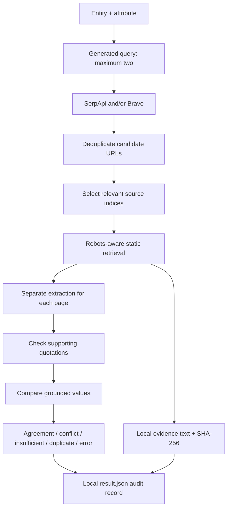

# Deliverable 2 — multi-source comparison

This implementation extends autonomous discovery with several source pages and
an optional second search provider. It does not change `agent.py` (Week 1) or
`autonomous.py` (Deliverable 1).

## What it does

1. Gemini generates a query from an entity and attribute, without a supplied URL
   or reference answer. Queries must include the entity. Domains are prohibited
   initially; a second query can use domains found in search results.
2. SerpApi, Brave, or both return up to ten candidates per query. The default is
   SerpApi. Using `both` calls each provider explicitly; there is no hidden switch
   to a service you did not select. One failed provider does not discard the other.
3. Gemini selects candidate indices for relevant pages, preferably original
   publications from diverse publishers. It cannot supply arbitrary new URLs.
4. The static retriever checks public HTTPS destinations and robots policies,
   bounds redirects/response sizes, and extracts page text without running scripts.
5. Each page is processed separately. Extraction sees the entity, attribute, and
   first 12,000 characters of that page, never the other pages' answers or snippets.
6. Mechanical checks require the value and entity quotations to occur in the
   supplied page text. Unsupported claims cannot contribute to agreement/conflict.
7. Grounded values are compared after whitespace and case normalization. Every
   grounded alternative is preserved; no majority vote silently chooses a winner.



## Setup

Use the existing project environment and pinned dependencies. No new package is
required. Commands below assume the project is your current folder. On macOS:

```sh
cd /Users/jaideepmanupati/Downloads/Programming/ai-data-retrieval-agent
source .venv-v020/bin/activate
```

For a fresh clone, follow the main README's Python, dependency, and browser setup;
activate that environment instead. Windows can run its environment's Python
executable or activate it as described there.

Keep `SERPAPI_KEY`, `GEMINI_API_KEY`, and `GEMINI_MODEL` in `.env`. To enable Brave:

1. Visit https://api-dashboard.search.brave.com and activate an appropriate plan.
   Review the displayed price and terms yourself; no subscription is purchased by
   this code. The current quickstart includes a payment-information step.
2. Create an API key in the dashboard.
3. Add `BRAVE_SEARCH_API_KEY=your_actual_key` to your existing local `.env`.
   Do not replace existing keys or paste keys into chat, commits, or screenshots.
4. `.env.example` contains an empty optional Brave setting. It contains no secrets.

A search provider key is needed only when that provider is selected. Gemini is
still used for query generation, selection, and extraction in every mode.
Environment variables take precedence over `.env` values.

## Run

```sh
python multisource.py --entity "PEP 703" --attribute title --provider serpapi
python multisource.py --entity "PEP 703" --attribute title --provider brave
python multisource.py --entity "PEP 703" --attribute title --provider both
```

Each command creates a new `runs/multisource-<UTC timestamp>/` folder. Runs are
ignored by Git. Optional `--output-dir runs/my-check` must name a new directory.
`--max-sources 3` is the default; allowed values are 2–5. This is a cap on source
attempts, including failed fetches, not a promise of three usable sources.

At most two queries, four search calls in `both` mode, two selection calls, and
five extraction calls are possible. Actual counts and model token usage are in
the record. See evaluation-step3-findings.md for the completed Deliverable 3 evaluation.

## Reading results

| Decision | Meaning | Exit code |
|---|---|---|
| AGREEMENT_OBSERVED | At least two distinct page texts contain matching grounded strings | 0 |
| CONFLICT | At least two grounded values differ after basic normalization | 2 |
| INSUFFICIENT_EVIDENCE | Fewer than two usable source claims | 2 |
| DUPLICATE_EVIDENCE | Matching claims come only from identical captured text | 2 |
| ERROR | Run-level failure or all attempted searches failed | 1 |

**Exit 0 does not establish truth or source independence.** Every completed
comparison reports `verified_truth: false` and `independence: NOT_ESTABLISHED`.
Official documentation and its GitHub mirror may agree because they share an
origin. Different hostnames are counted for inspection, not treated as proof of
independent publishers. Identical final URLs are counted only once. Exact text
hashes detect exact copies; near-duplicates, syndication, and common ownership
are not automatically resolved.

The audit record includes generated queries, provider attempts and timings,
search candidates, selection reasons, source/final URLs, source-level errors,
quotes and values, capture times, SHA-256 hashes, evidence filenames, retrieval
and model-input character counts, model name/call usage, robots checks, grouped
values, and total elapsed time. A failed source does not erase successful ones.
Errors retain their type, not raw exception messages that might contain keys.
Full cleaned text stays local; only its prefix is sent to Gemini. Search queries
are sent to the selected provider(s). Do not enter confidential research records
without first checking the relevant service and institutional requirements.

## Limits and interpretation

- This comparator is intended initially for scalar text attributes such as a
  document title. It does not normalize currencies, units, time periods, synonyms,
  or numeric tolerances. Different spellings can cause a false conflict.
- Quote occurrence checks are necessary, not sufficient: a page can mention an
  entity and a value in unrelated contexts, or quote a false claim. Review context.
- Page text and snippets are untrusted. Prompts direct the model to ignore their
  instructions; this is not a formal prompt-injection security guarantee.
- Static HTML/plain text only. PDFs, login walls, and JavaScript-only content may
  fail. No access restriction is bypassed. Check site terms in addition to robots.
- robots.txt 404/410 is treated as no declared restriction, not legal permission.
  Unavailable/denying policies block retrieval; explicit crawl-delay requirements
  currently cause abstention because a scheduler is not implemented.
- DNS is checked before requests but resolved again during transport; this is not
  hardened against DNS rebinding. Use controlled egress before broad deployment.
- The second query is a bounded retry, not an exhaustive search. Search results
  and model outputs can change over time. A source failure consumes the attempt
  budget. Exact-text duplicate detection cannot establish publisher independence.
- No source URLs or official-answer oracle are embedded in this implementation.
  A model may nevertheless recall facts from training; this is not held-out proof.

## Tests and troubleshooting

```sh
python -m unittest discover -s tests -v
# macOS/Linux: include the baseline's local Chromium smoke test
RUN_BROWSER_TESTS=1 python -m unittest discover -s tests -v
```

Missing key: add it to the local `.env`, or select a provider whose key is already
configured. A placeholder is not a usable key. Authentication/quota/service errors
are recorded as search failures. Check your provider dashboard without publishing
its credentials. A missing/blocked page leads to fewer usable claims; review the
source status and robots record. Unsupported evidence can mean the relevant text
is beyond the 12,000-character prefix. A new output directory avoids overwriting
previous evidence.

Provider references (checked 2026-10-28):
- Brave quickstart: https://api-dashboard.search.brave.com/documentation/quickstart
- Authentication: https://api-dashboard.search.brave.com/documentation/guides/authentication
- Web search: https://api-dashboard.search.brave.com/app/documentation/web-search

Brave is the selected alternative because it offers an independent web index and
a direct REST web-search endpoint. SerpApi remains supported and is the default.
Multiple websites can be retrieved through either provider; multiple APIs are not
a prerequisite for multi-source comparison. Both modes automate discovery once
credentials are configured. Completed live provider checks are reported separately from
mocked tests in `multisource-step2-findings.md`.
