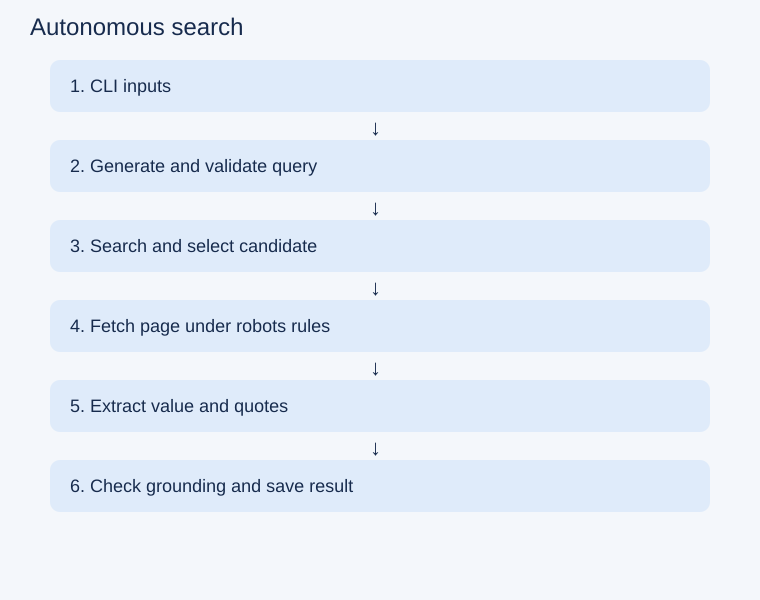
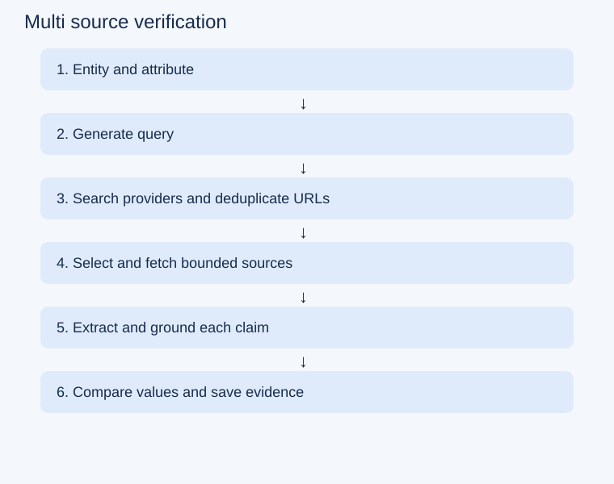
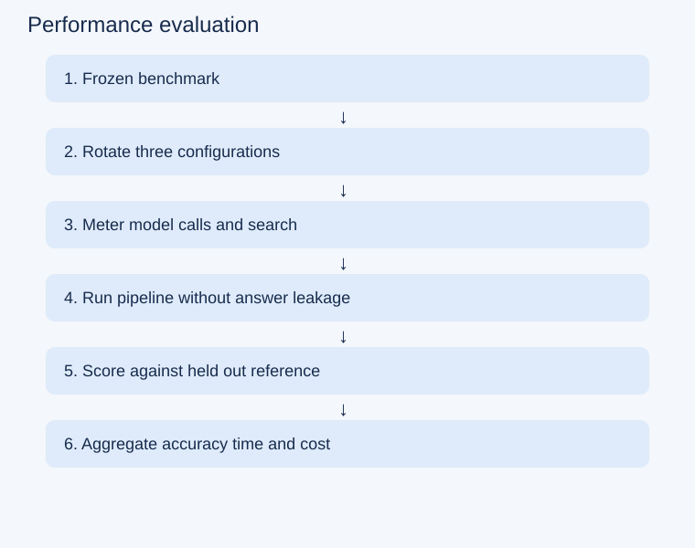
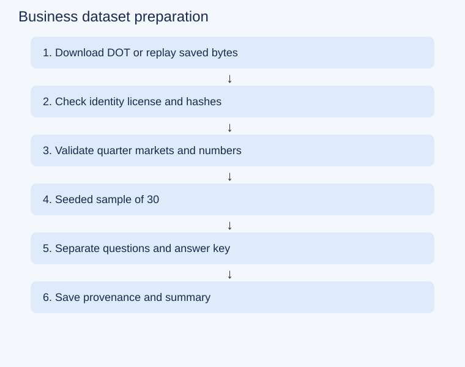

# Week 2 code and architecture guide

Open `docs/walkthrough/index.html` in a browser. It is a self-contained offline teaching animation, not a live trace. Use task tabs, Play/Pause, Next, and the function search. The displayed code is a snapshot of the commented source. No API request is made by the page.

To serve locally from the repository root:

```sh
python3 -m http.server 8765 --bind 127.0.0.1 --directory docs/walkthrough
```

Visit http://127.0.0.1:8765 and stop with Ctrl+C. Only the walkthrough directory is served, not .env or runs.

## Four tasks

### 1. Autonomous search

Entry file: `autonomous.py`. Flow: CLI inputs → Generate and validate query → Search and select candidate → Fetch page under robots rules → Extract value and quotes → Check grounding and save result.

A missing or rejected candidate can trigger one reformulation. Unsupported evidence abstains; exceptions record ERROR.



[Mermaid source](walkthrough/task-1.mmd)

### 2. Multi source verification

Entry file: `multisource.py`. Flow: Entity and attribute → Generate query → Search providers and deduplicate URLs → Select and fetch bounded sources → Extract and ground each claim → Compare values and save evidence.

At most two queries and a configured page-attempt budget. Conflict or agreement stops further searching; failed individual sources remain recorded.



[Mermaid source](walkthrough/task-2.mmd)

### 3. Performance evaluation

Entry file: `evaluate.py`. Flow: Frozen benchmark → Rotate three configurations → Meter model calls and search → Run pipeline without answer leakage → Score against held out reference → Aggregate accuracy time and cost.

The assisted baseline receives a reference; autonomous calls do not. A rate limit stops the experiment and preserves partial results.



[Mermaid source](walkthrough/task-3.mmd)

### 4. Business dataset preparation

Entry file: `prepare_business_data.py`. Flow: Download DOT or replay saved bytes → Check identity license and hashes → Validate quarter markets and numbers → Seeded sample of 30 → Separate questions and answer key → Save provenance and summary.

This prepares data only. It does not run a business retrieval agent or claim airline accuracy.



[Mermaid source](walkthrough/task-4.mmd)

## Explaining a run

`main` handles CLI configuration. `run` coordinates research operations. `StructuredModel.ask` validates model output; `Retriever` handles bounded HTTP access; `supported_claim` checks literal evidence. `multisource.compare` decides whether grounded strings agree. `evaluate.score` separately checks the candidate against a frozen reference. `prepare_business_data.prepare` creates data, not business-agent results.

Running autonomous.py still uses its existing CLI and does not automatically open a browser. This avoids changing experiment behavior. Read its private result.json to inspect actual decisions; the animation is illustrative and does not claim a successful run.

Comments were added without changing the Python AST. Historical evaluation source hashes refer to the original release bytes, which naturally differ after comments. v0.2.0 remains the reproducibility snapshot. The original agent.py is preserved unchanged.

## Start here without a terminal

Double-click `docs/walkthrough/index.html`. No installation, server, Python process or API key is needed for the teaching page. Choose a task, then use Next step. Each stage explains its input, operation and output. Open “Show the Python behind this step” only when needed. Play explanation advances the teaching steps; it does not run the agent. Use the optional function search for deeper study.
