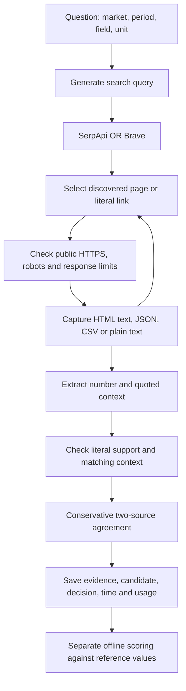

# Week 3 Part 2: DOT retrieval development pilot

This part adds a business-data retrieval path and tests only the six development
observations with SerpApi and Brave (12 trials). The other 24 observations remain
held out from live tuning. This is a development record, not the final Week 3 report.

## Code and flow

`business_agent.py` adds strict input and claim schemas, Decimal parsing, literal
numeric support, market/period/unit checks, linked-resource discovery, evidence
capture and conservative agreement. It does not import or read a reference key.
`evaluate_business.py` runs the paired pilot with shared pacing, then scores saved
results in a separate command. The agent receives data only and has no filesystem,
shell or code-execution tools. This is an auditable program boundary, not an OS
sandbox against a malicious local operator; public references may also have been
seen in model pretraining.



The original `agent.py`, `autonomous.py` and `multisource.py` are unchanged.
The shared search adapter adds safe error-status metadata so authentication and
quota failures can stop a batch. Week 2 adapter behavior otherwise remains intact.

The first numerically grounded candidate is fixed before scoring. A number from
the wrong quarter may be numerically correct but contextually wrong. A correct
candidate can still remain unresolved without corroboration. Actual accepted
values are scored separately from first-candidate correctness.

## Limits and provenance

Each trial has at most two search calls, three page attempts and ten model calls.
Gemini requests are spaced at least seven seconds apart across trials, with a
2,048-token output cap. SDK retries are disabled. Provider order alternates by
observation. Authentication/quota failures stop the batch; individual timeouts and
server failures remain visible failed trials. Existing output folders are refused.

No known DOT domain, endpoint, dataset ID or expected answer is supplied to the
agent. It can follow literal links discovered on fetched pages; it cannot invent
API endpoints. Search snippets are discovery data, never verification evidence.
The existing public-HTTPS, DNS destination, robots, redirect and 2 MB response
checks are reused. These do not constitute full DNS-rebinding protection.

Each run saves input and code hashes in `manifest.json`. Each trial saves
`result.json`, `model-usage.json` and evidence text with timestamps and hashes.
Scoring creates `scored-results.json`. Raw artifacts remain under ignored `runs/`.
No keys are included in reports; exception types/statuses replace raw error text.

## Reproduce

Activate the project's working environment with its pinned dependencies, and keep
existing API keys in the ignored `.env`. No additional package or key is needed.

```sh
python -m unittest discover -s tests -v
python evaluate_business.py check
python evaluate_business.py run --output-dir runs/week3-dot-pilot-NEW
python evaluate_business.py score --output-dir runs/week3-dot-pilot-NEW
```

`check` and `score` make no API calls. `run` defaults to airfare-01 through
airfare-06 and both providers. Choose a new folder for any rerun and report it
separately. Do not run the held-out cases while still tuning on development data.

Optional `--rates path/to/rates.json` supplies USD scenario assumptions using keys
`serpapi_per_search`, `brave_per_search`, `model_input_per_million`,
`model_cached_per_million`, `model_output_per_million`. Missing rates or incomplete
usage produce an unknown total, not zero. Estimated costs are not invoices and do
not subtract account credits automatically.

## Limitations

- PDF, XLSX and JavaScript-only tables remain unsupported. JSON/CSV must be discovered.
- Only the first 40 unique HTTPS links per HTML page are considered. HTML text may
  lose table structure. Long text is limited to a header and windows around question
  identifiers; saved offsets show what was sent, but relevant records can be missed.
- Exact city labels and explicit quarter text can reject valid aliases or alternative
  period formats. Numeric quotations do not prove that all context belongs to one row.
  Definition/unit interpretation remains model-assisted and requires evidence audit.
- Exact Decimal agreement is stricter than reference scoring tolerances; rounding
  may produce conflict. Two different texts do not establish independent sources.
- The proposed single-authoritative-source rule is not implemented here. Part 3
  investigates verification policy changes and compares them on saved evidence.
- Six development cases cannot establish which search provider is generally better.

## Results

Run `week3-dot-pilot-20261105-v1` completed on 5 November 2026 (America/New_York).
All 12 planned trials were attempted. No retries, alternate model or selective
replacement of failed trials were used. The executed source files and hashes are
preserved privately alongside the run. Sanitized results are in
[week3-dot-pilot-results.json](week3-dot-pilot-results.json).

| Measure | SerpApi | Brave |
| --- | ---: | ---: |
| Development observations | 6 | 6 |
| Exact numeric candidates correct | 0/6 | 0/6 |
| Contextually correct candidates | 0/6 (0%) | 0/6 (0%) |
| Trials with a captured page | 2/6 (33.3%) | 3/6 (50%) |
| Accepted answers | 0/6 | 0/6 |
| Incorrectly accepted answers | 0/6 | 0/6 |
| Mean elapsed time including pacing | 38.26 s | 36.08 s |
| Median elapsed time including pacing | 27.98 s | 41.84 s |
| Successful search responses / attempts | 10/10 | 9/9 |
| Model requests | 26 | 31 |
| Trial outcomes | 3 errors, 3 insufficient evidence | 4 errors, 2 insufficient evidence |

All candidates remained unresolved. Accepted precision and cost per correct
accepted answer are undefined, because no answers were accepted. Page-capture
success is a transport measure; these captured pages did not yield grounded exact
answers. Neither provider can be declared superior from these results.

### Failure audit

Five model requests failed: four HTTP 503 responses and one HTTP 504 response.
There were no recorded HTTP 429 quota failures. This is why these trials cannot be
interpreted as purely a search-quality comparison. Two other trials ended after
query generation in the query-validation step. Their source selections were valid.
The rejected query proposals were not preserved by this first implementation;
the precise offending text is unknown and proposal logging needs improvement.

The discovery chain includes the official 2024 Q4 Domestic Airline Fares Consumer
Report PDF and official BTS fare/airport pages. Selecting a relevant official link
was insufficient: the current retriever does not support PDF, and the captured
pages did not explicitly supply the requested city-market/quarter values. All
recorded extracted claims had null values. Consequently this pilot does not yet
isolate correct-answer rejection by verification; there were no correct grounded
candidates for that analysis.

### Cost and quota interpretation

The pilot made 19 search requests and 57 model requests. These fit the reported
140 remaining SerpApi searches and, assuming 255 of 500 Gemini requests were used,
245 remaining Gemini requests. Seven-second pacing was applied. Google states
that rate limits apply per project, not per key:
[Gemini rate limits](https://ai.google.dev/gemini-api/docs/rate-limits).

Cost estimates use an explicit paid-tier scenario, not actual charges. The
SerpApi rate of $0.025/search is the same allocation assumption used in Week 2,
not a claim about the user's free allowance or current marginal price. Brave uses
the user's reported $5/1,000-search plan assumption. Gemini uses $0.30 per million
input tokens, $0.03 cached input and $2.50 output including thinking, from the
[Gemini pricing page](https://ai.google.dev/gemini-api/docs/pricing) checked for
this run. Search credits and free-tier model usage may reduce actual charges.

Five failed model calls have no returned usage metadata. Full modeled cost is
therefore unknown, not zero. The JSON reports known-usage subtotals separately
from the null full-cost total; these must not be presented as an invoice.

### Verification and next discussion

The full offline suite completed: 90 tests passed and one optional browser test was skipped.
There are 24 new tests covering business retrieval/scoring, reference-field
rejection, failure handling, precision, discovery chains, paired order, reference
read separation and pacing. All 30 input rows validate; the original business
sample hashes still match. Git whitespace checks pass, and `.env` and raw run
artifacts are ignored. No commit, tag or push was made for this part.

Before any held-out evaluation, address discovered document formats and query
proposal diagnostics on development data. Then investigate the authority-aware
verification policy in Part 3. Run the 24 held-out observations only after the
retrieval and verification design is frozen for the provider comparison. The
professor's full Week 3 experiment and final report are not complete yet.

### Recorded usage and partial scenario costs

| Provider | Usage records / model calls | Input tokens | Output tokens | Known model usage scenario | Search scenario |
| --- | ---: | ---: | ---: | ---: | ---: |
| serpapi | 23/26 | 35589 | 1102 | $0.012927 | $0.250 |
| brave | 29/31 | 45806 | 1461 | $0.017394 | $0.045 |

The partial subtotals exclude unknown usage for failed model calls. Full cost remains unknown.
